# Manual do gestor e do supervisor

Este manual explica como usar a aplicação web do Clean&Check com o perfil de **administrador** (gestor) ou de **supervisor**. Cobre a configuração, os cadastros, o acompanhamento das tarefas e os relatórios.

Os prestadores usam a aplicação móvel e não têm acesso a estas páginas.

As capturas usam dados fictícios.

## Índice

1. [Entrar e sair](#1-entrar-e-sair)
2. [Visão geral e menu](#2-visão-geral-e-menu)
3. [Cadastros](#3-cadastros)
4. [Configuração](#4-configuração)
5. [Operação do dia a dia](#5-operação-do-dia-a-dia)
6. [Relatórios](#6-relatórios)

## 1. Entrar e sair

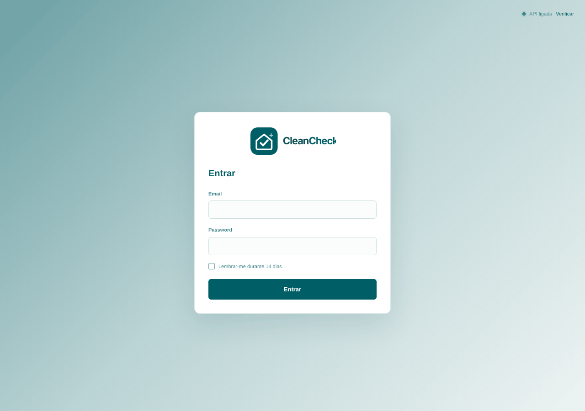

1. Abra o endereço da aplicação web.
2. Escreva o **Email** e a **Password** da sua conta.
3. Marque **Lembrar-me durante 14 dias** se estiver num computador pessoal.
4. Carregue em **Entrar**.

Para sair, carregue em **Terminar sessão**, no canto superior direito.

O indicador **API ligada** no topo mostra se a aplicação está a comunicar com o servidor. Se aparecer outro estado, carregue em **Verificar**.

## 2. Visão geral e menu

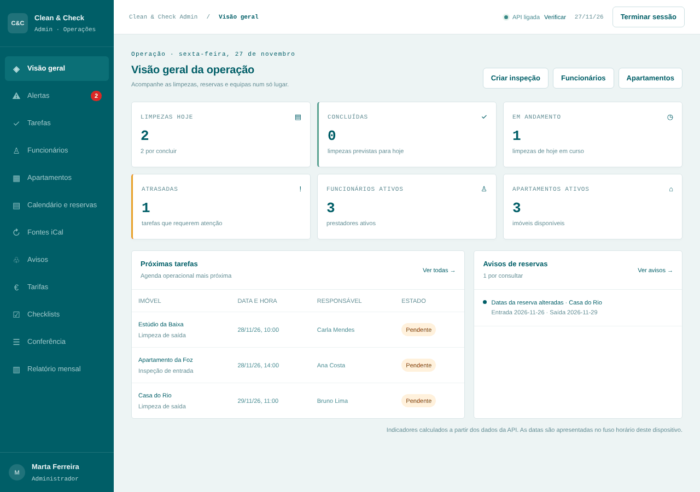

A **Visão geral** é a primeira página depois de entrar. Mostra:

- **Limpezas hoje**, **Concluídas** e **Em andamento**: as tarefas previstas para hoje.
- **Atrasadas**: tarefas que precisam de atenção.
- **Funcionários ativos** e **Apartamentos ativos**.
- **Próximas tarefas**: a agenda mais próxima, com o imóvel, a data, o responsável e o estado.
- **Avisos de reservas**: alterações de reservas por consultar.

Os botões **Criar inspeção**, **Funcionários** e **Apartamentos** levam diretamente a essas páginas.

O menu à esquerda dá acesso a todas as páginas:

| Página | Para que serve |
|---|---|
| Visão geral | Resumo do dia |
| Alertas | Tarefas atrasadas ou em risco |
| Tarefas | Lista e agenda das limpezas e inspeções, atribuição de prestadores |
| Funcionários | Prestadores (equipas de limpeza) |
| Apartamentos | Imóveis geridos |
| Calendário e reservas | Importação manual de reservas a partir de um ficheiro iCal |
| Fontes iCal | Calendários do Airbnb e do Booking sincronizados por imóvel |
| Avisos | Alterações de reservas |
| Tarifas | Valores pagos por serviço |
| Checklists | Itens que o prestador confirma em cada tarefa |
| Conferência | Lançamentos de serviço e ajustes |
| Relatório mensal | Apuramento mensal por prestador |

Num ecrã pequeno, o menu abre no botão **Menu**.

## 3. Cadastros

A ordem recomendada para começar é: funcionários, apartamentos e, por fim, as fontes iCal de cada apartamento.

### 3.1 Funcionários (prestadores)

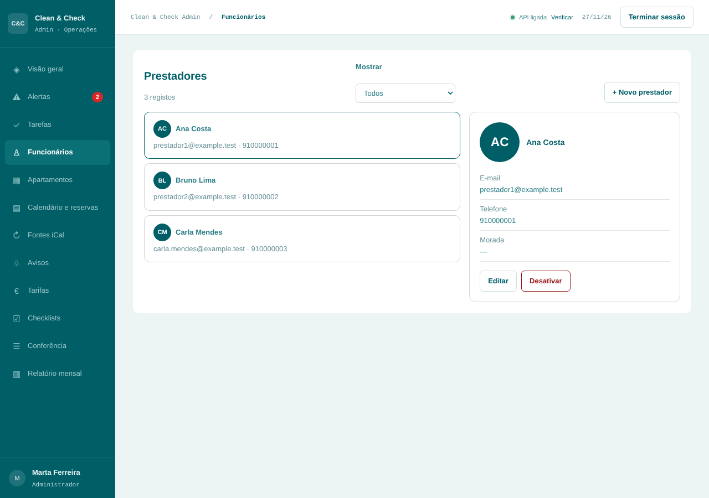

A lista mostra os prestadores com o email e o telefone. Use **Mostrar** para ver todos, só os ativos ou só os inativos. Selecione um prestador para ver os detalhes, **Editar** ou **Desativar**.

Para criar um prestador:

1. Carregue em **+ Novo prestador**.
2. Preencha **Nome**, **E-mail**, **Telefone** e **Password inicial** (obrigatórios).
3. Opcionalmente, escolha uma fotografia (JPG, PNG ou WEBP, até 2 MB) e preencha a morada.
4. Carregue em **Criar prestador**.

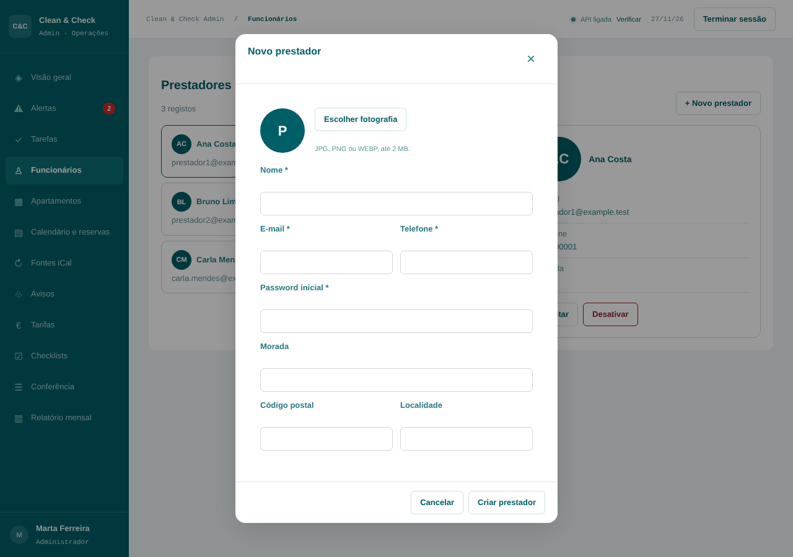

O prestador entra na aplicação móvel com o email e a password inicial.

Um prestador desativado deixa de poder entrar e deixa de aparecer nas listas de atribuição. O histórico das tarefas dele mantém-se.

### 3.2 Apartamentos (imóveis)

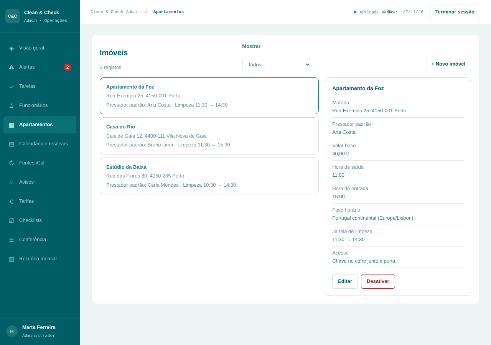

A lista mostra cada imóvel com a morada, o prestador padrão e a janela de limpeza. Selecione um imóvel para ver os detalhes, **Editar** ou **Desativar**.

Para criar ou alterar um imóvel, carregue em **+ Novo imóvel** ou em **Editar**:

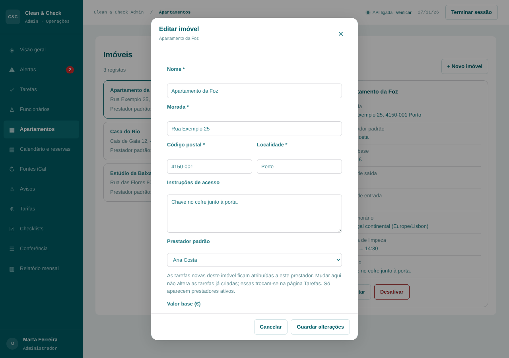

| Campo | O que indicar |
|---|---|
| Nome, Morada, Código postal, Localidade | Identificação do imóvel (obrigatórios) |
| Instruções de acesso | Onde está a chave, códigos da porta, etc. O prestador vê esta informação |
| Prestador padrão | Prestador a quem ficam atribuídas as tarefas novas deste imóvel |
| Valor base (€) | Valor usado quando não há tarifa para o serviço (ver [Tarifas](#41-tarifas)) |
| Hora de saída e Hora de entrada | Horas a que o hóspede sai e o próximo entra, iguais às do anúncio no Airbnb ou no Booking |
| Fuso horário | Fuso do imóvel; as horas das tarefas usam este fuso |

A **janela de limpeza** é calculada a partir dos horários: começa 30 minutos depois da saída e acaba 30 minutos antes da entrada.

Mudar o prestador padrão só se aplica às tarefas criadas a partir desse momento. Para trocar o prestador de uma tarefa que já existe, use a página [Tarefas](#51-tarefas).

### 3.3 Fontes iCal

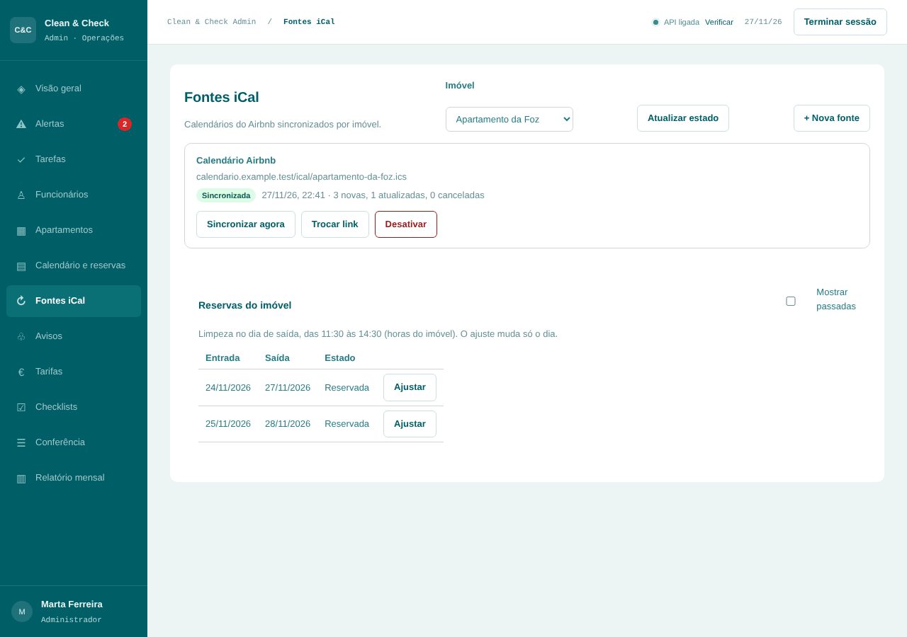

As fontes iCal ligam cada imóvel ao calendário do Airbnb ou do Booking. As reservas importadas criam as tarefas de limpeza automaticamente.

1. Escolha o **Imóvel**.
2. Carregue em **+ Nova fonte** e cole o link iCal do anúncio.
3. A sincronização automática corre a cada 30 minutos. Para sincronizar já, carregue em **Sincronizar agora**.

Em cada fonte:

- O estado **Sincronizada** mostra a data da última sincronização e quantas reservas foram criadas, atualizadas ou canceladas.
- Se aparecer **Desatualizada**, carregue em **Sincronizar agora**. Se o problema continuar, contacte a equipa técnica.
- **Trocar link** substitui o link do calendário; **Desativar** deixa de sincronizar essa fonte.

Em **Reservas do imóvel** vê as reservas importadas. Use **Ajustar** para mudar o dia de uma reserva só nesta aplicação (por exemplo, quando o hóspede combinou outra data de saída). Marque **Mostrar passadas** para ver as reservas antigas.

### 3.4 Calendário e reservas (importação manual)

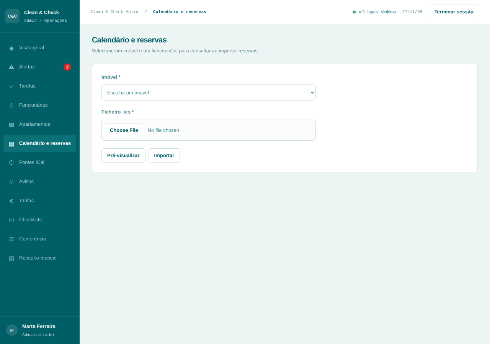

Use esta página quando quiser importar um ficheiro `.ics` descarregado, em vez de um link:

1. Escolha o **Imóvel** e o **Ficheiro .ics**.
2. Carregue em **Pré-visualizar** para confirmar as reservas que vão ser importadas.
3. Carregue em **Importar**.

## 4. Configuração

### 4.1 Tarifas

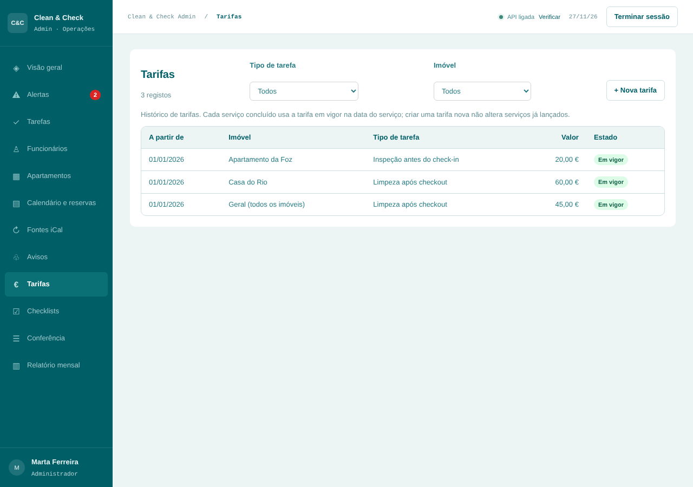

As tarifas definem quanto vale cada serviço. A página mostra o histórico de tarifas, com a data a partir da qual se aplicam e o estado (**Em vigor** ou antiga). Pode filtrar por **Tipo de tarefa** e por **Imóvel**.

Para criar uma tarifa:

1. Carregue em **+ Nova tarifa**.
2. Em **Aplica-se a**, escolha **Todos os imóveis (tarifa geral)** ou um imóvel.
3. Escolha o **Tipo de tarefa**: limpeza após checkout ou inspeção antes do check-in.
4. Indique o **Valor**, a **Moeda** e a data em **Aplica-se a partir de**.
5. Carregue em **Criar tarifa**.

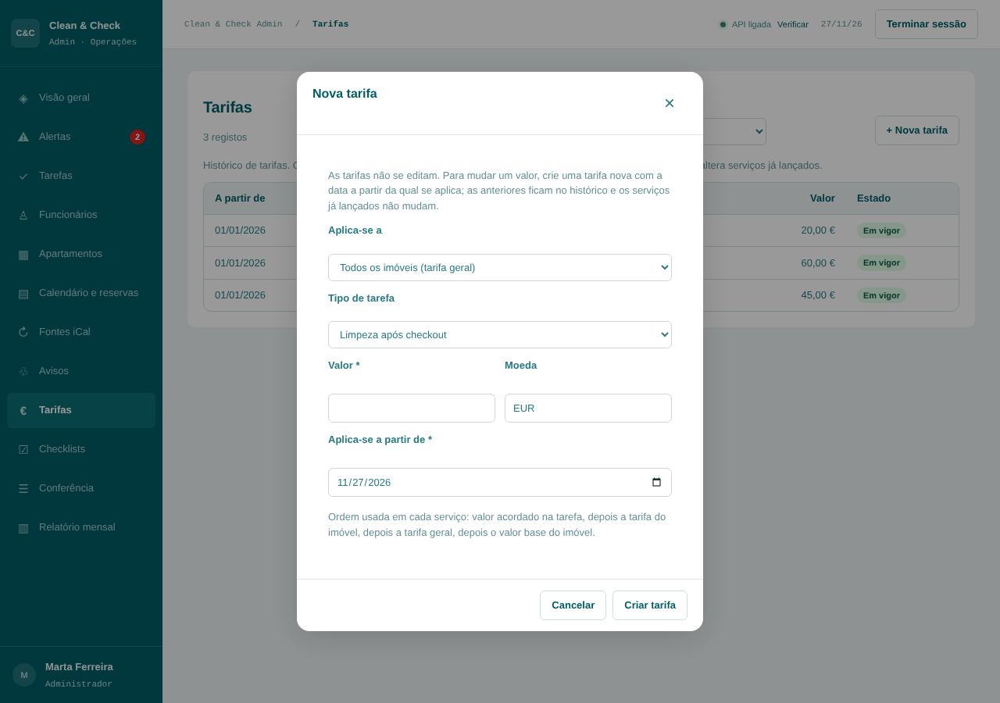

As tarifas não se editam. Para mudar um valor, crie uma tarifa nova com a data a partir da qual se aplica. As anteriores ficam no histórico e os serviços já lançados não mudam.

O valor de cada serviço é escolhido por esta ordem:

1. o valor acordado na própria tarefa, se existir;
2. a tarifa do imóvel para esse tipo de tarefa;
3. a tarifa geral;
4. o valor base do imóvel.

### 4.2 Checklists

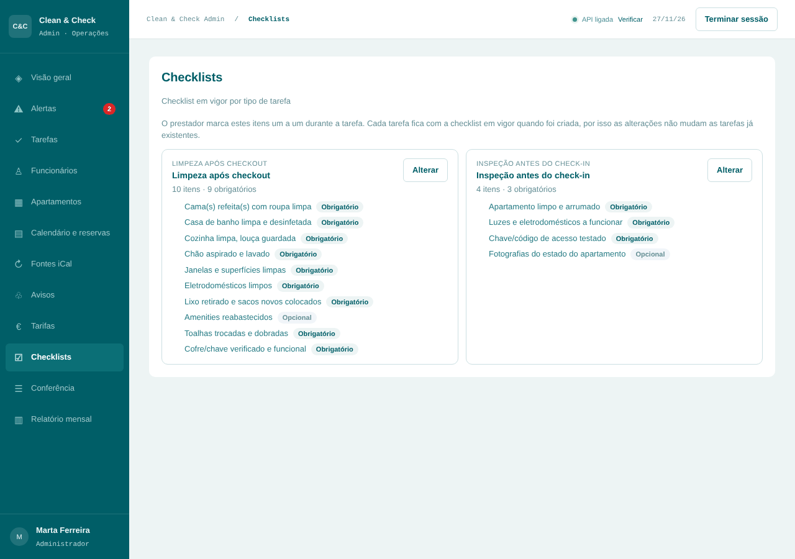

A checklist é a lista de itens que o prestador confirma durante a tarefa. Existe uma checklist para cada tipo de tarefa: **limpeza após checkout** e **inspeção antes do check-in**. A página mostra a checklist em vigor de cada tipo, com os itens por ordem e a indicação **Obrigatório** ou **Opcional**.

Para alterar uma checklist (ou criar, se o tipo ainda não tiver):

1. Carregue em **Alterar** (ou **Criar**).
2. Mude o **Nome da checklist**, se quiser.
3. Em cada item, escreva o texto e marque ou desmarque **Obrigatório**.
4. Use os botões de subir e descer para mudar a ordem, o botão de remover para apagar um item e **Adicionar item** para acrescentar.
5. Carregue em **Guardar**.

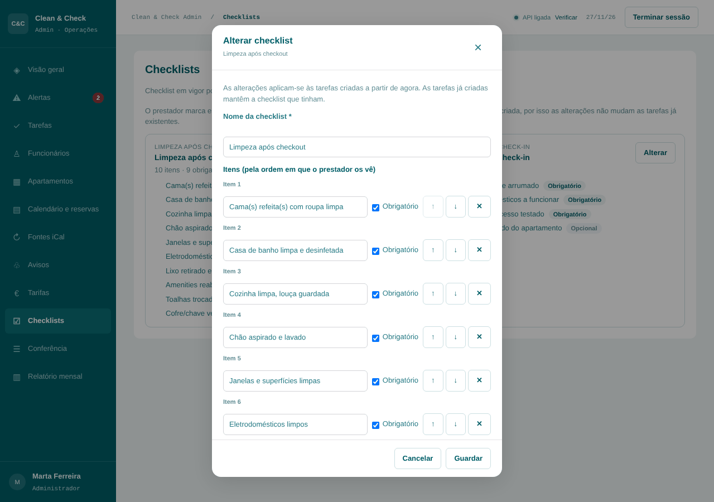

As alterações aplicam-se às tarefas criadas a partir desse momento. As tarefas já criadas mantêm a checklist que tinham, para o histórico não mudar.

### 4.3 Prestador padrão e valor base

Estes dois valores configuram-se em cada imóvel (ver [Apartamentos](#32-apartamentos-imóveis)):

- o **prestador padrão** recebe automaticamente as tarefas novas do imóvel;
- o **valor base** é usado quando não há valor acordado nem tarifa para o serviço.

## 5. Operação do dia a dia

### 5.1 Tarefas

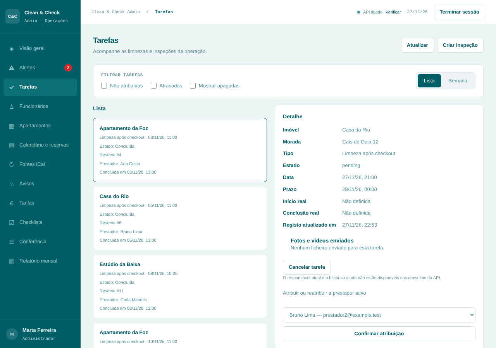

A página **Tarefas** mostra as limpezas e as inspeções, com o imóvel, o tipo, a data, o estado e o prestador. As tarefas atrasadas aparecem destacadas a vermelho.

- **Lista** e **Semana** mudam a forma de ver as tarefas.
- Os filtros **Não atribuídas**, **Atrasadas** e **Mostrar apagadas** limitam a lista.
- **Atualizar** volta a carregar as tarefas.
- **Criar inspeção** cria uma tarefa de inspeção manualmente.

Selecione uma tarefa para ver o detalhe: datas previstas e reais, fotos e vídeos enviados pelo prestador.

Para atribuir ou trocar o prestador de uma tarefa:

1. Selecione a tarefa.
2. Em **Atribuir ou reatribuir a prestador ativo**, escolha o prestador.
3. Carregue em **Confirmar atribuição**.

Se o prestador escolhido já tiver outra tarefa à mesma hora, a aplicação mostra um aviso.

**Cancelar tarefa** cancela a tarefa selecionada.

### 5.2 Alertas

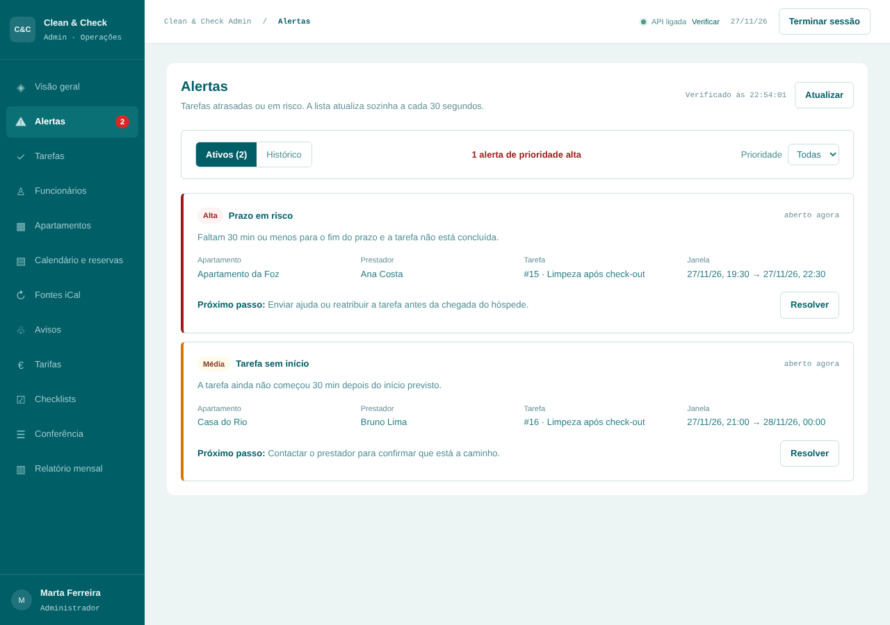

A página **Alertas** mostra as tarefas atrasadas ou em risco. A lista atualiza sozinha a cada 30 segundos e o número de alertas ativos aparece no menu.

| Alerta | Prioridade | Quando aparece |
|---|---|---|
| Tarefa sem início | Média | A tarefa ainda não começou 30 minutos depois do início previsto |
| Prazo em risco | Alta | Faltam 30 minutos ou menos para o fim do prazo e a tarefa não está concluída |

Cada alerta indica o imóvel, o prestador, a tarefa, a janela e o **próximo passo** recomendado (por exemplo, contactar o prestador ou enviar ajuda).

Os alertas fecham sozinhos quando a tarefa começa, é concluída, cancelada ou reagendada. Para fechar um alerta manualmente, carregue em **Resolver** e indique o motivo. Os alertas fechados ficam no separador **Histórico**. Use **Prioridade** para filtrar.

### 5.3 Avisos

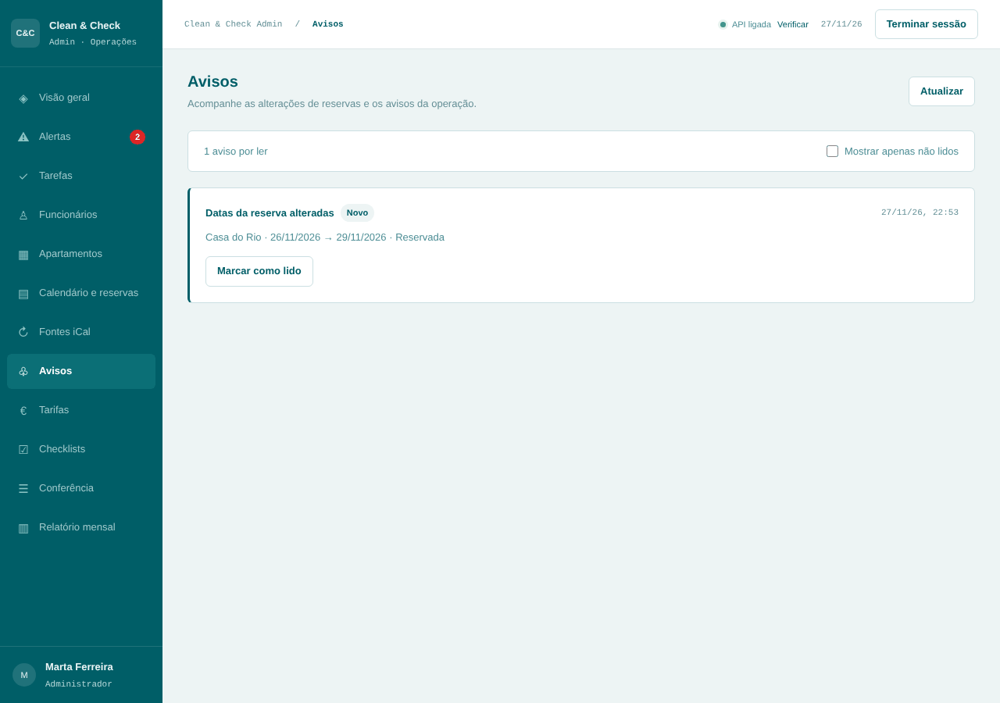

A página **Avisos** mostra as alterações de reservas, por exemplo datas alteradas ou reservas canceladas. Os avisos novos aparecem marcados como **Novo**.

- Carregue em **Marcar como lido** depois de tratar o aviso.
- Marque **Mostrar apenas não lidos** para ver só os que faltam tratar.

## 6. Relatórios

### 6.1 Conferência

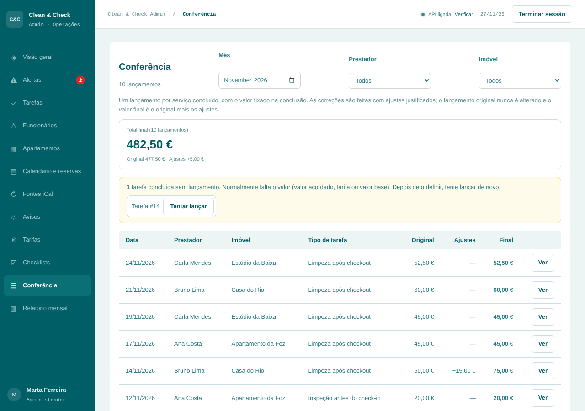

Quando uma tarefa é concluída, a aplicação cria um **lançamento** com o valor do serviço, fixado nesse momento. A página **Conferência** serve para rever esses lançamentos.

- Filtre por **Mês**, **Prestador** e **Imóvel**.
- O **Total final** mostra a soma do mês, com o valor original e os ajustes.
- A tabela mostra cada lançamento com o valor **Original**, os **Ajustes** e o valor **Final**.

**Tarefas concluídas sem lançamento**: se aparecer o aviso amarelo, normalmente falta o valor do serviço (valor acordado, tarifa ou valor base). Defina o valor, por exemplo criando a tarifa em falta, e carregue em **Tentar lançar**.

Para corrigir o valor de um serviço, use um ajuste:

1. Carregue em **Ver** no lançamento.
2. Em **Novo ajuste**, escreva o **Valor do ajuste**: negativo para reduzir, positivo para aumentar.
3. Escreva o **Motivo**.
4. Carregue em **Registar ajuste**.

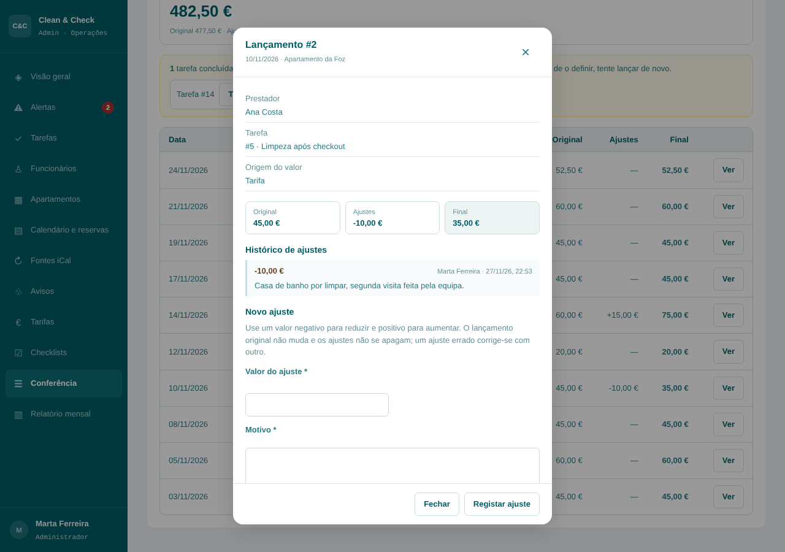

O lançamento original nunca é alterado e os ajustes não se apagam. O detalhe mostra o histórico de ajustes, com quem os fez e quando. Um ajuste errado corrige-se com outro ajuste. O valor final pode chegar a zero, mas nunca fica negativo.

### 6.2 Relatório mensal

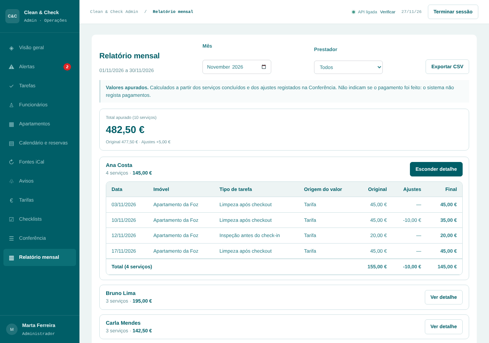

O **Relatório mensal** mostra o apuramento das limpezas e dos valores de cada prestador.

1. Escolha o **Mês** e, se quiser, um **Prestador**.
2. Veja o **Total apurado** do mês e o cartão de cada prestador, com o número de serviços e o total.
3. Carregue em **Ver detalhe** para ver os serviços do prestador: data, imóvel, tipo, origem do valor, original, ajustes e final, com a linha de total.
4. Carregue em **Exportar CSV** para descarregar o relatório com os filtros escolhidos.

O ficheiro CSV abre diretamente no Excel em português: tem uma linha por serviço, uma linha de total por prestador e o total geral.

Os valores são **apurados**: são calculados a partir dos serviços concluídos e dos ajustes. Não indicam se o pagamento foi feito, porque a aplicação não regista pagamentos.

A soma do detalhe de cada prestador é sempre igual ao total do prestador, e a soma dos prestadores é igual ao total geral.
